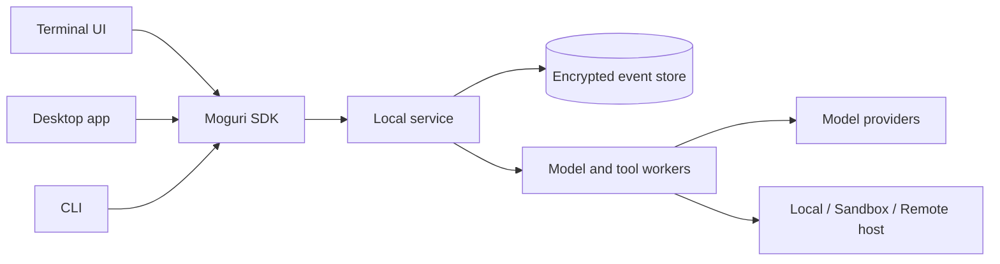

<p align="center">
  
</p>

# Moguri

[](LICENSE.md)


[Documentation](docs/README.md) · [Installation](docs/installation.md) · [Roadmap](docs/remaining-milestone-gaps.md) · [Issues](https://github.com/mbianchidev/moguri/issues) · [Releases](https://github.com/mbianchidev/moguri/releases)


Moguri is a model-agnostic AI harness for serious engineering work. It runs
coding agents on your terms: you pick the model, where it executes, how much
it may do without asking, and how much it may spend. The same sessions are
available from a terminal UI, a desktop app, a CLI and an importable SDK. One
local service on your machine is the single source of truth.

It is for developers who want an agent they can inspect and stop, with
approvals, budgets and execution boundaries that are enforced by the service
rather than promised by a prompt. Moguri is original code built on maintained
open-source libraries. It is not a fork of another agent.

> [!NOTE]
> Moguri is an **alpha** for macOS on Apple silicon. Builds are ad-hoc signed
> and not notarized. See [what is not available yet](docs/remaining-milestone-gaps.md).

## Contents

- [Quickstart](#quickstart)
- [Why Moguri](#why-moguri)
- [How it works](#how-it-works)
- [Get started](#get-started)
- [Features](#features)
- [Documentation](#documentation)
- [AI policy](#ai-policy)
- [Contributing](#contributing)
- [Security](#security)
- [License](#license)

## Quickstart

**From a release.** Download the DMG and `SHA256SUMS` from
[Releases](https://github.com/mbianchidev/moguri/releases), verify the
checksum, and drag Moguri onto Applications. The build is not notarized, so
the first launch needs **System Settings > Privacy & Security > Open Anyway**.
Follow the [installation guide](docs/installation.md) for the exact steps.

**From source** (macOS on Apple silicon, Node.js 26):

```sh
git clone https://github.com/mbianchidev/moguri.git
cd moguri
npm ci
npm run build
npm start -- --project /absolute/path/to/project
```

The terminal UI opens on that project. Press **Ctrl+L** to sign in to GitHub
Copilot, **Ctrl+M** to choose a model and **Ctrl+K** for commands, then send a
prompt. Run `npm run desktop` in another terminal to open the same sessions in
the desktop app. You complete each provider's sign-in yourself; Moguri does not
read IDE login files.

## Why Moguri

- **Any model, one workflow.** GitHub Copilot, OpenRouter, the Anthropic API,
  the OpenAI API, a ChatGPT account, OpenAI-compatible endpoints and local
  models. **Kupo** can route a task across the models you configured.
- **Autonomy you choose per session.** Manual (the default) asks before every
  command and edit. Guided recommends, and you confirm. Autonomous and Autopilot
  approve tools automatically within hard policy, which always wins.
- **Explicit execution boundaries.** Run on your Mac (Local), in a SendBox VM
  (Sandbox) or on your own SSH machine (Remote host). Moguri never silently falls
  back to Local.
- **Budgets and honest accounting.** Optional token and USD caps cover every
  model call. Unknown usage is shown as unknown, never as zero cost.
- **Nothing is lost.** Drafts, queues, sessions and artifacts survive
  restarts and crashes. Stopping work records exactly what was cancelled.
- **Tradeoffs.** macOS on Apple silicon only, alpha quality, and many
  advanced workflows are still on the [roadmap](docs/remaining-milestone-gaps.md).

## How it works



Every client talks to one local service through the same typed SDK, so a
session started in the terminal continues in the desktop app. The service
records everything as an append-only, versioned event stream in an encrypted
SQLite store, and migrates it forward on upgrade. Model calls and tools run in
supervised workers that the service can cancel. See the
[architecture overview](docs/architecture/overview.md).

## Get started

- **Composer controls:** every session has **Env**, **Model**,
  **Autonomy level** and **Budget**. Defaults are Local, no model until you
  sign in, Manual and Unlimited. Override them globally, per profile, per
  project or per session.
- **Providers and models:** connect them under **Settings > Models >
  Providers**, or configure [local models](docs/settings/local-models.md).
- **Projects:** add a repository and Moguri works in managed Git worktrees,
  normally finishing with a draft PR you review.
- **Command line:** install the `moguri` command from **Settings > General**
  ([details](docs/installation.md#command-line-tool)).

The [setup guide](docs/setup.md) covers every workflow, and the
[Settings reference](docs/settings/README.md) covers every option.

## Features

- Terminal UI and Electron desktop app sharing one local service, plus a CLI
  and an importable SDK
- Streamed conversations with queue, steer and interrupt delivery, persistent
  drafts and held prompts, scheduled prompts and automations
- Taggable `@` personas in linked subsessions and read-only dependency update
  roundups
- Native file, terminal and browser tools with reviewed approvals and a
  website allowlist
- Local, SendBox Sandbox and SSH Remote host environments with visible boundaries
- Kupo automatic routing, cascade and critique workflows, context compaction
  and per-call accounting
- Local Git, GitHub (issues, PRs, reviews, CI watching, releases) and Linear
  workflows
- Skills, plugins, an MCP gateway, repository memory and optional OpenTelemetry
  export, all off by default where they affect privacy
- Dashboard, Inbox, session analytics, profiles, themes and voice dictation

[Implemented capabilities](docs/features.md) records the full detail per
checkpoint, and [product vision](docs/vision.md) lists planned work, which is
not implemented yet.

## Documentation

The [documentation index](docs/README.md) links everything:
[installation](docs/installation.md) and [setup](docs/setup.md) for users,
[development](docs/development.md) and [releasing](docs/releasing.md) for
contributors, and the [architecture](docs/architecture/overview.md) and
[SDK](docs/sdk.md) references.

## AI policy

You are responsible for everything you contribute, including AI-assisted code,
documentation and assets. Review and test your contribution. You must be able
to explain what the code does and why it is needed.

## Contributing

Contributions are welcome. Read [CONTRIBUTING.md](CONTRIBUTING.md) first.
Coding agents must also follow [AGENTS.md](AGENTS.md). Everyone follows the
[Code of Conduct](CODE_OF_CONDUCT.md).

## Security

Report vulnerabilities privately as described in [SECURITY.md](SECURITY.md),
never in a public issue.

## License

Moguri is licensed under the [MIT License](LICENSE.md). Third-party components
keep their own licenses; see [third-party components](docs/third-party.md).
